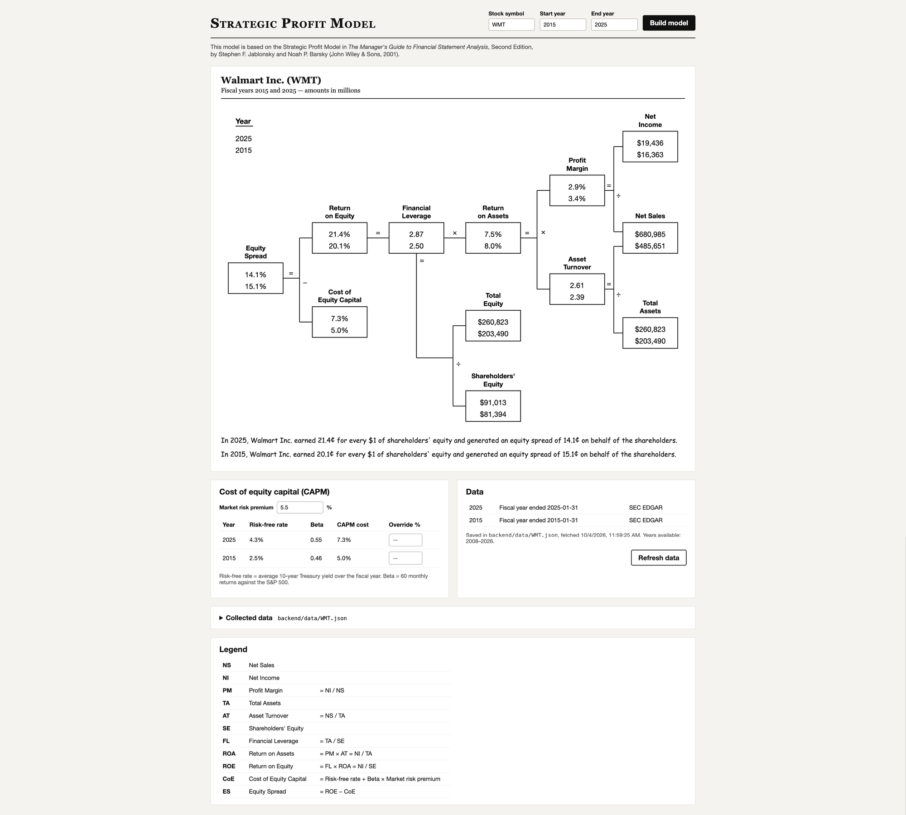

# Strategic Profit Model

Vite + React single page app with a FastAPI backend (run by `uv`) that builds a
Strategic Profit Model for a stock symbol and a start/end fiscal year.



## Run

Terminal 1 — backend (http://localhost:8000):

```sh
cd backend
uv run uvicorn main:app --reload --port 8000
```

Terminal 2 — frontend (http://localhost:5173, proxies `/api` to the backend):

```sh
cd frontend
npm install
npm run dev
```

## Data

The backend saves each company's data to `backend/data/<SYMBOL>.json` and reuses
it on later requests. Use the **Refresh data** button (or `refresh=true`) to fetch again.

| Element | Source |
|---|---|
| Net Sales, Net Income, Total Assets, Shareholders' Equity | SEC EDGAR 10-K XBRL facts (fiscal years ~2009 onward); gaps filled from Yahoo Finance (last ~4-5 years, also covers non-US tickers) |
| Risk-free rate | FRED `GS10`, average 10-year Treasury yield over the fiscal year |
| Beta | 60 monthly returns vs. S&P 500 ending at fiscal year end (Yahoo Finance) |

The SEC asks API clients to identify themselves. Set your own contact string:

```sh
export SEC_USER_AGENT="Your Name your.email@example.com"
```

## Formulas

| Abbreviation | Meaning | Formula |
|---|---|---|
| NS | Net Sales | |
| NI | Net Income | |
| PM | Profit Margin | = NI / NS |
| TA | Total Assets | |
| AT | Asset Turnover | = NS / TA |
| SE | Shareholders' Equity | |
| FL | Financial Leverage | = TA / SE |
| ROA | Return on Assets | = PM × AT = NI / TA |
| ROE | Return on Equity | = FL × ROA = NI / SE |
| CoE | Cost of Equity Capital | = Risk-free rate + Beta × Market risk premium<br>(CAPM, editable in the UI) |
| ES | Equity Spread | = ROE − CoE |

## API

`GET /api/model?symbol=WMT&start=2015&end=2025[&refresh=true]`
